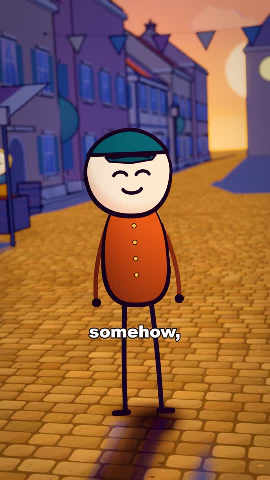
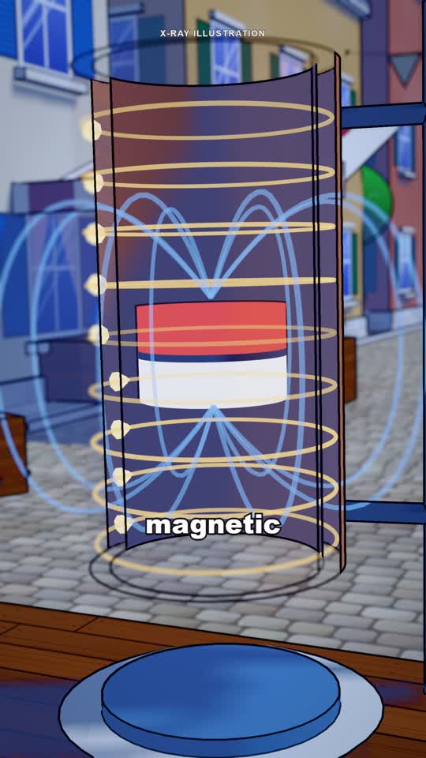
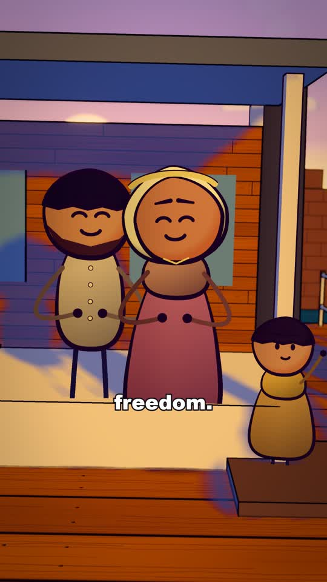

# Three animated shorts

A dark production journal and three original cartoon shorts: a sunset style test, a science explanation, and a character-centered history story.

[Read the dark production journal](https://az9713.github.io/claude-animated-shorts/)

The visual workflow was inspired by [How to Make Viral Animated Shorts Using Claude (Full Workflow)](https://www.youtube.com/watch?v=OtbLL6OBNE4). The journal cites the original YouTube video's English captions with timestamp links.

Click a screenshot to open full-size playback. The adjacent native video control plays inline on GitHub; use its Play button. Inline previews are smaller copies; full-resolution originals remain available below.

## Sunset style test

10.2 seconds. A small fictional deadline tests expressions, a walk, camera movement and golden light.

<table>
<tr><th>Screenshot: full-size player</th><th>Play inline</th></tr>
<tr><td></td><td><video controls width="270" src="https://raw.githubusercontent.com/az9713/claude-animated-shorts/main/previews/sunset.mp4"></video></td></tr>
</table>

[Full-resolution MP4](01-sunset-style-test.mp4) · [Production notes](production/sunset.md) · [Validation](validation/sunset.json)

## The Magnet That Fell in Slow Motion

60 seconds. A copper-tube experiment explains magnetic braking, induced currents and the effect of a slit.

<table>
<tr><th>Screenshot: full-size player</th><th>Play inline</th></tr>
<tr><td></td><td><video controls width="270" src="https://raw.githubusercontent.com/az9713/claude-animated-shorts/main/previews/magnet.mp4"></video></td></tr>
</table>

[Full-resolution MP4](02-magnet-slow-motion-60s.mp4) · [Production notes](production/magnet.md) · [Validation](validation/magnet.json)

## The Captain’s Hat — Robert Smalls

60 seconds. A researched history story carried by the decisions and reactions of Smalls, his crew and his family.

<table>
<tr><th>Screenshot: full-size player</th><th>Play inline</th></tr>
<tr><td></td><td><video controls width="270" src="https://raw.githubusercontent.com/az9713/claude-animated-shorts/main/previews/smalls.mp4"></video></td></tr>
</table>

[Full-resolution MP4](03-robert-smalls-60s.mp4) · [Production notes](production/smalls.md) · [Validation](validation/smalls.json)

## What is included

- A self-contained dark HTML production journal with local video players, scene navigation, selectable captions and factual sources.
- Three full-resolution H.264/AAC videos at 1440×2560 and 30 fps.
- Small inline playback copies and a screenshot from each actual film.
- Sanitized production notes, science/history sources and validation reports.

## Open locally

Open [how-the-three-shorts-were-made.html](how-the-three-shorts-were-made.html) beside the three numbered MP4 files. The journal's text, artwork and interactions are inside the HTML. External sources require internet access.

## Evidence and provenance

The full-minute episodes include 210 and 196 caption words respectively. Saved checks cover frame count, picture content, frozen spans, timing and audio levels. The history episode was revised to keep characters central after feedback on the science explanation.

Physics sources include [Levin et al.](https://arxiv.org/abs/physics/0603270) and the [University of Sydney](https://www.physics.sydney.edu.au/super/physics_tut/VOLUME2/ER08SOL.PDF). History sources include the [National Park Service](https://www.nps.gov/articles/000/the-planter.htm) and the [U.S. House biography of Robert Smalls](https://history.house.gov/People/Detail/21764).

The supplied renderer derives from [Mr omi's MIT-licensed reconstruction](https://github.com/mromidev/claude-animated-shorts). Its source notice is retained in [LICENSE.source](LICENSE.source). The original reference footage is not included. This is a finished-media showcase and production journal, rather than a distribution of the complete editing environment.
